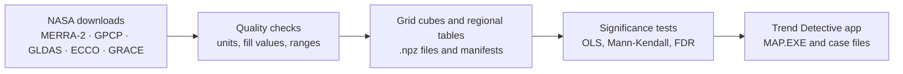

# Trend Detective

**NASA Space Apps Challenge 2026 · "Be An Earth System Trend Detective"**

> A trend line tells you what changed. Trend Detective tells you whether to believe it.

Trend Detective is a browser-based detective game built on NASA data. You log in to a retro desktop, choose a variable, a place and a time period, and the app tests the trend and returns one of three verdicts:

| Verdict | Meaning |
|---|---|
| **Detected** | The change is statistically significant at the 95% level, and both tests agree |
| **Not yet detectable** | No significant trend yet. The app estimates how many years of data would be needed |
| **Suspect** | The series contains a jump, such as a change in data source, so the result cannot be trusted as climate change |

---

## Project summary

**What we built.** A guided web app that walks students and the public through the evidence behind a climate trend. The main case is sea level along 31 Indonesian coastal cities, from the ECCO ocean model. MAP.EXE also covers air temperature, rainfall and water stored on land, and lets you draw a circle to average the grid cells inside it.

**How it addresses the challenge.** The challenge asks what is changing, where, how much, and whether the change is significant. Trend Detective answers each part:

- **Variables:** sea level, air temperature, rainfall and water storage on land, from ECCO, MERRA-2, GPCP, GRACE and GLDAS.
- **Where and how much:** a trend per year for each city or circle, with units and a 95% range.
- **Significance:** a trend test that adjusts for autocorrelation, a Mann-Kendall test with Sen's slope, and a comparison against 1,000 simulated trend-free records.
- **Opposite trends:** regions are shown side by side rather than averaged, and when many places are tested together, the Benjamini-Hochberg procedure controls false discoveries.

**Why it matters.** A trend line on its own invites over-reading. Monthly Earth data is autocorrelated, so a naive test claims more certainty than the data support, and a change in data source can look like a climate trend. Trend Detective marks those cases **Suspect** instead of reporting them as change. Sea level matters for places such as Jakarta, which floods partly because the ground is sinking. The sea-level data alone does not capture that, and the app says so on the case.

---

## Progress

The data pipeline has processed the Indonesia box (94–142° E, 12° S–7° N) for three gridded datasets. The chart below is drawn from the processed-cell manifests.


| Dataset | Months | Period | Grid (lat × lon) | Read errors |
|---|---|---|---|---|
| MERRA-2: temperature, humidity, pressure, precipitation, evaporation, surface temperature, VPD (3 collections) | 561 | Jan 1980 – Sep 2026 | 39 × 77 | 0 |
| GPCP v3.3 precipitation | 516 | Jan 1983 – Dec 2025 | 38 × 96 | 0 |
| GLDAS soil moisture, 0–10 cm | 319 | Jan 2000 – Jul 2026 | 76 × 192 | 0 |

Across the three datasets, 2,518 files were read with no errors. Fill values are masked before analysis. In the GLDAS box, 79% of values were fill values, so the land-only analysis uses the remaining 21%.



---

## Statistical significance

A trend is **Detected** only when two independent tests agree and both survive a correction for multiple testing.

| Check | Rule |
|---|---|
| Ordinary least squares (OLS) trend | Confidence interval adjusted for autocorrelation (Santer et al., 2000). The adjusted q-value must be below 0.05 |
| Mann-Kendall test | Rank-based test with Sen's slope. The q-value must be below 0.05 |
| Agreement | Both tests must be significant, and their slopes must have the same sign |
| Many places tested together | Benjamini-Hochberg adjusts p-values to control the false discovery rate at 5% |
| Data quality | A step-change screen runs first. A jump gives **Suspect** |
| Chance check | 1,000 simulated trend-free records with the same variability are compared with the real trend |
| Not yet detectable | If no trend is significant, a simulation estimates how many years a trend of this size would need |

**Why this ties to the solution.** The challenge asks whether a change is significant, and that question is easy to get wrong. Each verdict is a check a scientist would make before calling a trend real: whether the slope stands out from the noise, whether two methods agree, whether testing many places inflates the results, and whether a data break explains the change. Players see the evidence behind each verdict, rather than trusting a line.

---

## How it works

1. **Log in.** Click the monitor in the office to open TD-OS.
2. **Set up a case.** Choose a variable, a place and a period. The app keeps the period within the record it holds.
3. **Test the trend.** The app runs the quality checks, the trend tests and the chance check.
4. **Get a verdict.** The result is one of the three verdicts above, with the reasons in plain words.
5. **Explore on MAP.EXE.** The map shows trends for each city or circle, and a circle tool averages the grid cells inside it.

---

## Running it

The web app lives in `nasa/web`.

```bash
cd nasa/web
npm install
npm run dev
```

Build for production with `npm run build`. The output goes to `nasa/web/dist/`.

### Python analysis and API

```bash
cd nasa
pip install -e ".[dev]"
./scripts/check.sh                      # architecture checks, lint and tests; silent on success
python src/trend_detective/app/web.py   # local Flask API on 127.0.0.1:5000
```

### Pulling NASA data

Temperature from NASA POWER needs no login:

```bash
python scripts/pull_nasa.py power --lat 1.35 --lon 103.9 --params T2M --start 1981 --end 2024
```

Other datasets use Earthdata Login. Store the credentials once in `~/.netrc`, never in the repo:

```bash
pip install earthaccess xarray netCDF4 h5netcdf
python -c "import earthaccess; earthaccess.login(persist=True)"
python scripts/pull_nasa.py catalog --show
```

---

## Project structure

Paths are relative to `nasa/`.

```
app.py                  Vercel entry point for the Flask API
src/trend_detective/
  ingest/               the only code that touches the network (NASA downloads)
  catalog/              variables, regions, scope (1980-2018), known discontinuities
  core/                 statistics: trend tests, detection, significance
  process/              builds cells, regional tables and GeoJSON from raw files
  app/                  Flask API that serves the analysis
web/                    Vite front end (desktop UI, map and case flow)
scripts/                data pulls, processing and asset builds
tests/                  app/, core/, process/, scripts/
docs/                   statistics, science rules, datasets, references, decisions
data/processed/         committed regional tables, cell cubes and GeoJSON
```

`scripts/check.sh` enforces the architecture: `core`, `process` and `app` never import `ingest`, and network libraries are only imported inside `ingest`. This keeps the statistics pure and testable offline.

---

## Known limitations

- MERRA-2 and GLDAS are **models** constrained by observations, not direct measurements.
- GRACE resolves about 3° mascons, so it cannot support city-scale water-storage claims.
- The sea-level case does not include land subsidence, which is a large part of flooding in Jakarta and Semarang.
- A trend test says *whether* something changed, not *why*.

---

## References

Full citations and access dates for each collection are in [`nasa/docs/references.md`](nasa/docs/references.md).

### Datasets

**Sea level (ECCO)**

- Forget, G., et al. (2015). ECCO version 4: an integrated framework for non-linear inverse modeling and global ocean state estimation. *Geoscientific Model Development*, 8, 3071–3104. https://doi.org/10.5194/gmd-8-3071-2015
- ECCO Consortium, Fukumori, I., Wang, O., Fenty, I., Forget, G., Heimbach, P., and Ponte, R. M. (2021). ECCO Sea Surface Height – Monthly Mean 0.5 Degree (Version 4 Release 4). PO.DAAC. https://doi.org/10.5067/ECG5M-SSH44

**Air temperature and rainfall (MERRA-2)**

- Gelaro, R., et al. (2017). The Modern-Era Retrospective Analysis for Research and Applications, Version 2 (MERRA-2). *Journal of Climate*, 30(14), 5419–5454. https://doi.org/10.1175/JCLI-D-16-0758.1
- GMAO (2015). MERRA-2 daily maximum 2 m air temperature (M2SDNXSLV), version 5.12.4. NASA GES DISC. https://doi.org/10.5067/9SC1VNTWGWV3
- GMAO (2015). MERRA-2 2 m air temperature (M2TMNXSLV), version 5.12.4. NASA GES DISC. https://doi.org/10.5067/AP1B0BA5PD2K
- GMAO (2015). MERRA-2 surface flux diagnostics, precipitation (M2TMNXFLX), version 5.12.4. NASA GES DISC. https://doi.org/10.5067/0JRLVL8YV2Y4
- GMAO (2015). MERRA-2 land surface diagnostics (M2TMNXLND), version 5.12.4. NASA GES DISC. https://doi.org/10.5067/8S35XF81C28F

**Rainfall (GPCP)**

- Adler, R. F., et al. (2003). The Version-2 Global Precipitation Climatology Project (GPCP) Monthly Precipitation Analysis (1979–Present). *Journal of Hydrometeorology*, 4(6), 1147–1167. https://doi.org/10.1175/1525-7541(2003)004<1147:TVGPCP>2.0.CO;2
- Huffman, G. J., and Bolvin, D. T. (2025). GPCP Precipitation Level 3 Monthly 0.5-Degree V3.3 (GPCPMON). NASA GES DISC. https://doi.org/10.5067/MEASURES/GPCP/DATA306

**Water storage on land (GRACE / GRACE-FO)**

- Watkins, M. M., et al. (2015). Improved methods for observing Earth's time variable mass distribution with GRACE using spherical cap mascons. *Journal of Geophysical Research: Solid Earth*, 120. https://doi.org/10.1002/2014JB011547
- Wiese, D. N., Yuan, D.-N., Boening, C., Landerer, F. W., and Watkins, M. M. JPL GRACE and GRACE-FO Mascon Ocean, Ice, and Hydrology Equivalent Water Height, JPL Release 06.3, Version 04. PO.DAAC. https://doi.org/10.5067/TEMSC-3MJ634

**Soil moisture and rainfall (GLDAS)**

- Rodell, M., et al. (2004). The Global Land Data Assimilation System. *Bulletin of the American Meteorological Society*, 85(3), 381–394. https://doi.org/10.1175/BAMS-85-3-381
- Beaudoing, H., and Rodell, M. (2020). GLDAS Noah Land Surface Model L4 monthly 0.25 x 0.25 degree V2.1 (GLDAS_NOAH025_M). NASA GES DISC. https://doi.org/10.5067/SXAVCZFAQLNO

### Methods

- Santer, B. D., et al. (2000). Statistical significance of trends and trend differences in layer-average atmospheric temperature time series. *Journal of Geophysical Research*, 105(D6), 7337–7356. https://doi.org/10.1029/1999JD901105
- Mann, H. B. (1945). Nonparametric tests against trend. *Econometrica*, 13, 245–259.
- Kendall, M. G. (1975). *Rank Correlation Methods*. Charles Griffin.
- Sen, P. K. (1968). Estimates of the regression coefficient based on Kendall's tau. *Journal of the American Statistical Association*, 63(324), 1379–1389.
- Benjamini, Y., and Hochberg, Y. (1995). Controlling the false discovery rate: a practical and powerful approach to multiple testing. *Journal of the Royal Statistical Society: Series B*, 57(1), 289–300.

---

## Credits

- 3D room: ["Detective's Office - True Detective Fan Art"](https://sketchfab.com/3d-models/detectives-office-true-detective-fan-art-a5d7f399d7694053affb63f069740c4a) by nickheitzman, licensed [CC BY 4.0](http://creativecommons.org/licenses/by/4.0/). Modified: retextured screen, mousepad, corkboard and poster; walls and ceiling added.
- Country outlines: Natural Earth, via world-atlas.
- Data: NASA POWER (MERRA-2), GRACE / GRACE-FO, GES DISC, PO.DAAC.

*Built for NASA Space Apps 2026 by Team SanSong, Singapore.*
