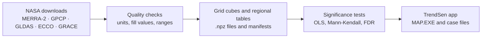

# TrendSen

**NASA Space Apps Challenge 2026 · "Be An Earth System Trend Detective"**

> A trend line tells you what changed. TrendSen tells you whether to believe it.

TrendSen (formerly Trend Detective) is a browser-based detective game built on NASA data. You log in to a retro desktop, choose a variable, a place and a time period, lock in a guess, and the app tests the trend and returns one of three verdicts, with a one-sentence reason in plain words:

| Verdict | Meaning |
|---|---|
| **Detected** | The change is statistically significant at the 95% level in both tests, fewer than 5% of 1,000 simulated trend-free records are as strong, and it holds up in every robustness check |
| **Suspect** | The change is statistically significant, but a safety check failed: it weakens when the earliest years are left out, or one unusual year drives much of it (or a known change of instrument sits inside the period). Treat it with caution |
| **Not yet detectable** | No significant trend yet, which includes any record under 10 years. The app estimates how many years of data would be needed, when it can. This does not mean nothing is changing |

---

## Project summary

**What we built.** A guided web app that walks students and the public through the evidence behind a climate trend. The main case is sea level along 23 coastal Indonesian cities (31 study cities in all; the 8 inland ones have no sea-level number), from the ECCO ocean model. MAP.EXE also shows six MERRA-2 layers: air temperature, land surface temperature, rainfall, humidity, vapour pressure deficit and evaporation. Click a city on any layer to investigate it as a case, or draw a circle to average the grid cells inside it.

**How it addresses the challenge.** The challenge asks what is changing, where, how much, and whether the change is significant. TrendSen answers each part:

- **Variables:** sea level (ECCO) and six MERRA-2 layers. GPCP rainfall, GLDAS soil moisture and GRACE water storage are processed by the data pipeline but are not in the current app.
- **Where and how much:** a trend per decade for each city, region box or circle, with units and a 95% range, in a monthly view and a yearly view.
- **Significance:** a trend test that adjusts for autocorrelation, a Mann-Kendall test with Sen's slope, a comparison against 1,000 simulated trend-free records, and robustness checks that ask whether the result survives dropping the earliest years or any single year.
- **Opposite trends:** regions are shown side by side rather than averaged. When many places are tested together (the circle tool, the region comparison), the Benjamini-Hochberg procedure controls false discoveries.

**Why it matters.** A trend line on its own invites over-reading. Monthly Earth data is autocorrelated, so a naive test claims more certainty than the data support, and a short or noisy record can look like a trend. TrendSen marks fragile results **Suspect** instead of reporting them as change, and says in plain words why. Sea level matters for places such as Jakarta, which floods partly because the ground is sinking. The sea-level data alone does not capture that, and the app says so on the case.

---

## Progress

The data pipeline has processed the Indonesia box (94–142° E, 12° S–7° N) for three gridded datasets. The chart below is drawn from the processed-cell manifests.


| Dataset | Months | Period | Grid (lat × lon) | Read errors | In the app |
|---|---|---|---|---|---|
| MERRA-2: temperature, humidity, pressure, precipitation, evaporation, surface temperature, VPD (3 collections) | 561 | Jan 1980 – Sep 2026 | 39 × 77 | 0 | Yes |
| GPCP v3.3 precipitation | 516 | Jan 1983 – Dec 2025 | 38 × 96 | 0 | Pipeline only |
| GLDAS soil moisture, 0–10 cm | 319 | Jan 2000 – Jul 2026 | 76 × 192 | 0 | Pipeline only |

ECCO sea level is processed separately, per city (1992 to 2017). Across the three gridded datasets, 2,518 files were read with no errors. Fill values are masked before analysis. In the GLDAS box, 79% of values were fill values, so the land-only analysis uses the remaining 21%.



GPCP, GLDAS and GRACE are in the pipeline but not shown in the current app.

---

## Statistical significance

A trend is **Detected** only when two independent tests agree, a chance check agrees, and the result survives the robustness checks. Each case is judged twice: on the monthly series (seasonal cycle removed) and on the yearly averages of those monthly anomalies.

| Check | Rule |
|---|---|
| Ordinary least squares (OLS) trend | Slope per decade with a 95% interval adjusted for autocorrelation (Santer et al., 2000), and the p-value from the effective sample size |
| Mann-Kendall test | Rank-based test with Sen's slope, with the variance adjusted for autocorrelation |
| Agreement | A rise or fall needs both p-values below 0.05 and the OLS and Sen slopes with the same sign. One test alone gives "unclear" |
| Many places tested together | Benjamini-Hochberg adjusts the p-values to control the false discovery rate at 5%. It applies to the circle tool (the cells inside a circle) and to TREND.EXE's comparison of regions. A single city or place in a case is judged on its own p-values, with no correction |
| Chance check (lineup) | 1,000 simulated trend-free records with the same autocorrelation, spread and missing months. Fewer than 5% may be as strong as the real trend. The simulation is seeded from the data, so the same record always gives the same answer |
| Robustness checks | At least 10 years of record. The two tests and the lineup agree. Cutting the first 3, 5 or 8 years (only if 10 years remain) must keep the same direction and a Mann-Kendall p below 0.1. Leaving out any one year must not move the slope by 35% or more. No known change of instrument inside the period (none is flagged for the current layers) |
| Not yet detectable | If no trend is significant, a simulation estimates how many years a trend of this size would need |
| Monthly and yearly | The slope is the same in both views, but the verdict can differ, because the two views carry different amounts of independent information. The result says which view has more, and never treats the difference as a contradiction |

The thresholds in the robustness checks (0.1, 35%, 3, 5 and 8 years) and the 0.15 limit for calling a result "borderline" are our own choices, not from a reference.

**Why this ties to the solution.** The challenge asks whether a change is significant, and that question is easy to get wrong. Each verdict is a check a scientist would make before calling a trend real: whether the slope stands out from the noise, whether two methods agree, whether testing many places inflates the results, and whether the result survives dropping the earliest years or one odd year. Players see the evidence behind each verdict, rather than trusting a line.

---

## How it works

1. **Log in.** Click the monitor in the office to open TD-OS.
2. **Pick a case.** Open a case file in CASES, or in MAP.EXE choose a layer, click a city (or a region box) and press INVESTIGATE AS A CASE. In SETUP choose the variable, the place and the years. The app keeps the years within the record it holds.
3. **Lock your guess.** Increase, decrease, no change or not sure, before any data is shown.
4. **Look.** PLOT shows the monthly record. Make your own call before the tests.
5. **Run the lineup.** The analysis engine tests the trend, runs the 1,000-record chance check and the robustness checks.
6. **Read the result.** A one-sentence headline says what was found and why. A MONTHLY | YEARLY switch shows the numbers, the checks, the histogram and a full chart for each view. Your guess is compared with the monthly verdict.
7. **Explore.** MAP.EXE shows the trend for every city on each layer and has a circle tool. TREND.EXE is a free explorer for the three region boxes, monthly, with verdicts corrected across the regions.

---

## Running it

The site and the analysis are two parts of one app: every lineup is computed by the Flask API, so the site cannot analyse anything without it. You need Python 3.11 or newer and Node 18 or newer.

```bash
cd nasa
python -m venv .venv && source .venv/bin/activate
pip install -e ".[dev]"
cd web && npm ci && npm run build && cd ..
python src/trend_detective/app/web.py        # serves the site and the API at http://127.0.0.1:5000
```

On macOS, port 5000 is often taken by AirPlay Receiver. Either turn that off, or run `python src/trend_detective/app/web.py --port 5077` and open that address.

For development with hot reload, keep Flask running on port 5000 and run `npm run dev` in `nasa/web`; the dev server forwards `/api` to port 5000.

### Checks

```bash
cd nasa
source .venv/bin/activate                 # check.sh only runs ruff and pytest if they are installed
bash scripts/check.sh                     # architecture checks, lint, tests, web build; silent on success
```

`check.sh` skips ruff and pytest when they are not on the PATH, so activate the virtual environment first or it can pass without running them. The committed data under `nasa/data/processed/` means no download is needed to run the app.

### Pulling NASA data

Temperature from NASA POWER needs no login:

```bash
python scripts/pull_nasa.py power --lat 1.35 --lon 103.9 --params T2M --start 1981 --end 2024
```

Other datasets use Earthdata Login. Store the credentials once in `~/.netrc`, never in the repo:

```bash
pip install earthaccess xarray netCDF4 h5netcdf
python -c "import earthaccess; earthaccess.login(persist=True)"
python scripts/pull_nasa.py catalog --show
```

---

## Project structure

Paths are relative to `nasa/`.

```
app.py                  Vercel entry point for the Flask API
src/trend_detective/
  ingest/               the only code that touches the network (NASA downloads)
  catalog/              variables, regions, scope (1980-2018)
  core/                 statistics: trend tests, significance, the lineup and case verdict
  process/              builds cells, regional tables, per-city case series and GeoJSON from raw files
  app/                  Flask API that serves the analysis
web/                    Vite front end (desktop UI, map and case flow)
scripts/                data pulls, processing and asset builds
tests/                  app/, core/, process/, scripts/, snapshots/
docs/                   statistics, science rules, datasets, references, decisions
data/processed/         committed regional tables, cell cubes and GeoJSON
```

`scripts/check.sh` enforces the architecture: `core`, `process` and `app` never import `ingest`, and network libraries are only imported inside `ingest`. This keeps the statistics pure and testable offline.

---

## Known limitations

- ECCO and MERRA-2 are **models** constrained by observations, not direct measurements.
- The sea-level case does not include land subsidence, which is a large part of flooding in Jakarta and Semarang.
- A trend test says *whether* something changed, not *why*.
- The robustness checks and their thresholds are our own design. The later-start check can be too strict on windows of about 12 to 20 years: on simulated genuine straight trends with Jakarta-like noise it flagged about 40% at 15 years and none at 26 years or more. A **Suspect** on a short window means "cannot confirm", not "false".
- The monthly and yearly views can disagree on significance, because monthly values are alike and so carry fewer independent values than they have rows.
- Each city case uses the one grid cell nearest to the city. The city card on the map averages the cells within 75 km, so the two numbers can differ slightly.
- Flood and drought event records are in the data file but have no analysis in the app yet.

---

## References

Full citations and access dates for each collection are in [`nasa/docs/references.md`](nasa/docs/references.md).

### Datasets

**Sea level (ECCO)**

- Forget, G., et al. (2015). ECCO version 4: an integrated framework for non-linear inverse modeling and global ocean state estimation. *Geoscientific Model Development*, 8, 3071–3104. https://doi.org/10.5194/gmd-8-3071-2015
- ECCO Consortium, Fukumori, I., Wang, O., Fenty, I., Forget, G., Heimbach, P., and Ponte, R. M. (2021). ECCO Sea Surface Height – Monthly Mean 0.5 Degree (Version 4 Release 4). PO.DAAC. https://doi.org/10.5067/ECG5M-SSH44

**Air temperature, rainfall, humidity and evaporation (MERRA-2)**

- Gelaro, R., et al. (2017). The Modern-Era Retrospective Analysis for Research and Applications, Version 2 (MERRA-2). *Journal of Climate*, 30(14), 5419–5454. https://doi.org/10.1175/JCLI-D-16-0758.1
- GMAO (2015). MERRA-2 daily maximum 2 m air temperature (M2SDNXSLV), version 5.12.4. NASA GES DISC. https://doi.org/10.5067/9SC1VNTWGWV3
- GMAO (2015). MERRA-2 2 m air temperature (M2TMNXSLV), version 5.12.4. NASA GES DISC. https://doi.org/10.5067/AP1B0BA5PD2K
- GMAO (2015). MERRA-2 surface flux diagnostics, precipitation (M2TMNXFLX), version 5.12.4. NASA GES DISC. https://doi.org/10.5067/0JRLVL8YV2Y4
- GMAO (2015). MERRA-2 land surface diagnostics (M2TMNXLND), version 5.12.4. NASA GES DISC. https://doi.org/10.5067/8S35XF81C28F

**Rainfall (GPCP), pipeline only**

- Adler, R. F., et al. (2003). The Version-2 Global Precipitation Climatology Project (GPCP) Monthly Precipitation Analysis (1979–Present). *Journal of Hydrometeorology*, 4(6), 1147–1167. https://doi.org/10.1175/1525-7541(2003)004<1147:TVGPCP>2.0.CO;2
- Huffman, G. J., and Bolvin, D. T. (2025). GPCP Precipitation Level 3 Monthly 0.5-Degree V3.3 (GPCPMON). NASA GES DISC. https://doi.org/10.5067/MEASURES/GPCP/DATA306

**Water storage on land (GRACE / GRACE-FO), pipeline only**

- Watkins, M. M., et al. (2015). Improved methods for observing Earth's time variable mass distribution with GRACE using spherical cap mascons. *Journal of Geophysical Research: Solid Earth*, 120. https://doi.org/10.1002/2014JB011547
- Wiese, D. N., Yuan, D.-N., Boening, C., Landerer, F. W., and Watkins, M. M. JPL GRACE and GRACE-FO Mascon Ocean, Ice, and Hydrology Equivalent Water Height, JPL Release 06.3, Version 04. PO.DAAC. https://doi.org/10.5067/TEMSC-3MJ634

**Soil moisture and rainfall (GLDAS), pipeline only**

- Rodell, M., et al. (2004). The Global Land Data Assimilation System. *Bulletin of the American Meteorological Society*, 85(3), 381–394. https://doi.org/10.1175/BAMS-85-3-381
- Beaudoing, H., and Rodell, M. (2020). GLDAS Noah Land Surface Model L4 monthly 0.25 x 0.25 degree V2.1 (GLDAS_NOAH025_M). NASA GES DISC. https://doi.org/10.5067/SXAVCZFAQLNO

### Methods

- Santer, B. D., et al. (2000). Statistical significance of trends and trend differences in layer-average atmospheric temperature time series. *Journal of Geophysical Research*, 105(D6), 7337–7356. https://doi.org/10.1029/1999JD901105
- Mann, H. B. (1945). Nonparametric tests against trend. *Econometrica*, 13, 245–259.
- Kendall, M. G. (1975). *Rank Correlation Methods*. Charles Griffin.
- Sen, P. K. (1968). Estimates of the regression coefficient based on Kendall's tau. *Journal of the American Statistical Association*, 63(324), 1379–1389.
- Benjamini, Y., and Hochberg, Y. (1995). Controlling the false discovery rate: a practical and powerful approach to multiple testing. *Journal of the Royal Statistical Society: Series B*, 57(1), 289–300.

---

## Credits

- 3D room: ["Detective's Office - True Detective Fan Art"](https://sketchfab.com/3d-models/detectives-office-true-detective-fan-art-a5d7f399d7694053affb63f069740c4a) by nickheitzman, licensed [CC BY 4.0](http://creativecommons.org/licenses/by/4.0/). Modified: retextured screen, mousepad, corkboard and poster; walls and ceiling added.
- Country outlines: Natural Earth, via world-atlas.
- Data: NASA GES DISC (MERRA-2, GPCP, GLDAS) and PO.DAAC (ECCO, GRACE / GRACE-FO). NASA POWER is used only by the optional quick-pull script.

*Built for NASA Space Apps 2026 by Team SanSong, Singapore.*
